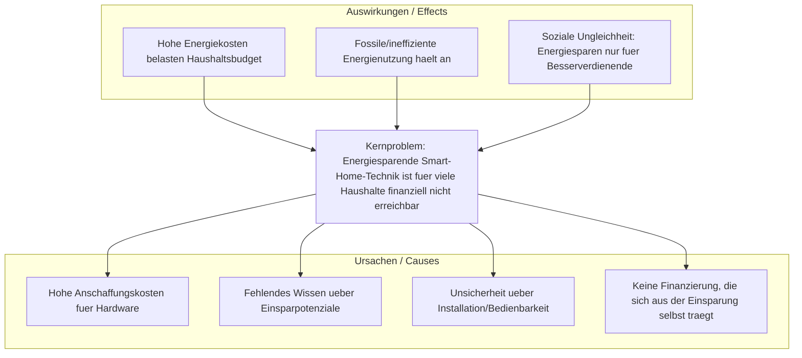

# Sprint 1: "Define and understand your problem"

Projekt: **SmartSave** – Smart Home für alle
Nachhaltigkeitsziel: **SDG 12 – Nachhaltige Konsum- und Produktionsmuster**

---

## 1. Nachhaltigkeitsziele – Team-Diskussion

| Ziel | Kernaussage | Bezug zu unserer Idee |
|---|---|---|
| Ziel 11 | Städte/Siedlungen inklusiv, sicher, widerstandsfähig, nachhaltig | eher Infrastruktur-/Stadtplanungs-fokussiert, weniger passend für ein einzelnes Haushaltsprodukt |
| Ziel 12 | Nachhaltige Konsum- und Produktionsmuster | direkter Bezug: Energieeinsparung im Haushalt, langlebige Hardware statt Wegwerfprodukte, bewusster Konsum durch Kostentransparenz |

**Entscheidung als Team: Ziel 12.** Begründung: Unser Produkt reduziert unmittelbar den Ressourcen-/Energieverbrauch von Haushalten und fördert durch das Abo-Modell einen bewussteren Umgang mit Energiekosten (Konsummuster-Änderung), statt nur auf städtische Infrastruktur einzuwirken.

---

## 2. Problem Tree

---

## 3. Persona

### 3.1 Demografische Merkmale
- **Name:** Sandra Wagner
- **Alter:** 38 Jahre
- **Wohnort:** Braunschweig, Mietwohnung (3-Zimmer)
- **Gender:** weiblich
- **Familienstand:** verheiratet, 2 Kinder (6 und 9 Jahre)

### 3.2 Sozioökonomische Merkmale
- **Bildungsstand:** Ausbildung zur Bürokauffrau
- **Beruf:** Teilzeit-Angestellte im Einzelhandel
- **Haushaltseinkommen:** ca. 3.200 € netto/Monat (Familie)

### 3.3 Kaufverhalten
- **Preissensibilität:** hoch – vergleicht Preise, nutzt Rabattaktionen
- **Mediennutzung:** Instagram, WhatsApp, gelegentlich Preisvergleichsportale
- **Zahlungsbereitschaft:** eher gering für Einmalzahlungen, offen für monatliche Raten, wenn nachvollziehbar kalkuliert

### 3.4 Psychografische Merkmale (should have)
- **Einstellungen/Werte:** möchte nachhaltig leben, aber ohne finanzielle Mehrbelastung
- **Wünsche:** Kontrolle über Energiekosten, mehr Sicherheit für die Kinder zuhause
- **Lebensstil:** organisiert, zeitknapp durch Beruf und Familie

### 3.5 Substitutionsgüter / Ängste (could have)
- **Substitutionsgüter am Markt:** einzelne smarte Steckdosen (Amazon Basics), Thermostat-Lösungen (tado°, Google Nest), Komplettpakete (Homematic IP) – meist als Einmalkauf
- **Ängste/Hürden:** Angst vor hohen Vorabkosten, Angst vor komplizierter Installation, Skepsis ob sich die Investition wirklich rechnet, Datenschutzbedenken

---

## 4. Empathy Map

|  | Inhalt |
|---|---|
| **Sehen (See)** | Steigende Stromrechnungen, Werbung für Smart-Home-Produkte, Nachbarn mit smarter Beleuchtung, Diskussionen in Elternchats über Energiesparen |
| **Hören (Hear)** | Freunde berichten von hohen Anschaffungskosten, Medienberichte über steigende Energiepreise, Partner drängt auf Kostenkontrolle |
| **Denken (Think)** | "Ich würde gerne Energie sparen, aber ich kann mir keine große Anfangsinvestition leisten." "Lohnt sich das überhaupt für uns?" |
| **Sagen (Say)** | "Wir müssen sparen." "Ich will nicht noch mehr Geld in Technik stecken, die ich nicht verstehe." |
| **Fühlen (Feel)** *(should have)* | Unsicherheit, Überforderung durch Technik, Sorge um Familienbudget, Hoffnung auf Entlastung |
| **Handeln (Do)** *(should have)* | Vergleicht Stromanbieter, schaltet Geräte manuell aus, informiert sich sporadisch über Fördermöglichkeiten, schiebt Kaufentscheidung auf |
| **Pain** *(could have)* | Hohe Vorabkosten, Zeitaufwand für Installation, Angst vor Fehlinvestition |
| **Gain** *(could have)* | Spürbare Kostenersparnis, mehr Sicherheit und Komfort, gutes Gewissen durch Nachhaltigkeit |

---

## 5. Problem Statement (5 Ws)

> **Unsere Zielgruppe** (Haushalte mit mittlerem Einkommen, wie unsere Persona Sandra) **hat das Problem**, dass sie sich energiesparende Smart-Home-Technik aufgrund hoher Anschaffungskosten nicht leisten kann, **obwohl** sie langfristig Energiekosten sparen könnte. **Dies tritt insbesondere beim Kauf/Einstieg in Smart-Home-Lösungen auf**, wenn hohe Einmalinvestitionen gefordert werden. **Unsere Lösung sollte liefern:** eine Möglichkeit, Smart-Home-Technik ohne Vorabinvestition zu nutzen, indem sich die monatlichen Kosten aus der tatsächlichen Energieersparnis finanzieren – **damit** auch Haushalte mit begrenztem Budget nachhaltig und komfortabel leben können.

**Kompakt:**
"Unsere Zielgruppe (einkommensbewusste Haushalte) hat das Problem, dass Smart-Home-Energiesparlösungen zu teuer in der Anschaffung sind. Unsere Lösung sollte liefern: ein Abo-Modell, das sich durch die eingesparten Energiekosten selbst finanziert, damit Energiesparen für alle erschwinglich wird."

---

## 6. Peer-to-Peer Feedback (Platzhalter)

| Feedback von Team ___ | Anmerkung | Reaktion / Anpassung |
|---|---|---|
|  |  |  |
|  |  |  |

*Nach dem Peer-Feedback: Ergänzungen/Änderungen an Persona, Empathy Map oder Problem Statement hier dokumentieren.*

---

## Nächste Schritte (Sprint 2)
- Solution-based 6-3-5 Brainwriting auf Basis dieses Problem Statements
- Customer Journey Mapping
- Customer Profile & Value Proposition
- Business Model Canvas
- Backlog-Erstellung
