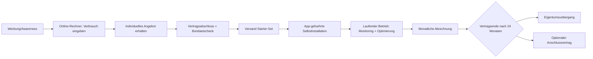

# Sprint 2: "Sketch out your solution"

Projekt: **SmartSave** – Smart Home für alle

---

## 1. Solution-based 6-3-5 Brainwriting (Ergebnis)

Ausgangspunkt: Problem Statement aus Sprint 1 ("Smart-Home-Energiesparlösungen sind für viele Haushalte zu teuer in der Anschaffung").

Gesammelte Lösungsideen (verdichtet aus der 6-3-5-Runde):
1. **Abo-Modell**, das sich aus der Energieersparnis finanziert (gewählte Lösung)
2. Leasing-Modell mit Rückgabeoption nach 12 Monaten
3. Genossenschaftsmodell: Nachbarschaften kaufen Hardware gemeinsam
4. Community-finanzierte Vorfinanzierung (Crowdfunding pro Haushalt)
5. Reines Miet-Modell ohne Eigentumsübergang
6. Energieversorger übernimmt Finanzierung gegen Vertragsbindung

## 2. Problem + Solution Stands (Verdichtung)

| Problem-Stand | Lösungs-Stand |
|---|---|
| Hohe Anschaffungskosten schrecken ab | Kein Vorabkauf nötig – Start ohne Investition |
| Unsicherheit über tatsächliche Ersparnis | Transparenter Online-Rechner + monatliches Reporting in der App |
| Angst vor komplizierter Installation | Plug-&-Play-Hardware, App-geführtes Setup, optionaler Vor-Ort-Service |
| Fehlende Bindung/Vertrauen in neue Anbieter | Kurze Testphase, transparente Vertragsbedingungen, Eigentumsübergang nach Laufzeitende |

**Konkretisierte Lösung:** SmartSave-Abo – Kund:innen zahlen weiterhin ca. ihre bisherigen Energiekosten plus einen moderaten Aufpreis; die Differenz zwischen alten und neuen (gesenkten) Energiekosten finanziert die Hardware über 24 Monate. Danach Eigentumsübergang.

---

## 3. Customer Journey Mapping

| Phase | Handlung der Kundin | Touchpoint | Gedanken/Gefühle | Chance/Verbesserung |
|---|---|---|---|---|
| **Awareness** | Sieht Social-Media-Anzeige "Smart Home, das sich selbst bezahlt" | Instagram/TikTok Ad | Neugier, Skepsis ("Klingt zu gut") | Klare Rechenbeispiele direkt in der Anzeige |
| **Consideration** | Nutzt Online-Rechner auf der Website | Website | "Würde sich das bei mir lohnen?" | Einfacher, schneller Rechner ohne Anmeldezwang |
| **Decision** | Schließt Abo online ab, gibt aktuellen Verbrauch an | Website/Checkout | Unsicherheit wegen Vertragsbindung | Klarer Vertrag, Widerrufsrecht deutlich sichtbar |
| **Onboarding** | Erhält Starter-Set, installiert via App | Hardware + App | Sorge vor Komplexität | Geführtes Setup mit Video-Anleitung, Chat-Support |
| **Usage** | Nutzt App zur Steuerung, sieht monatliche Ersparnis | App | Zufriedenheit bei sichtbarer Ersparnis | Push-Benachrichtigungen mit Erfolgsmeldungen |
| **Support** | Kontaktiert Support bei technischem Problem | Chat/Hotline | Frustration bei Problemen | Schnelle Reaktionszeit, Self-Service-FAQ |
| **Loyalty/Ende** | Vertragsende nach 24 Monaten, Eigentumsübergang | E-Mail/App | Stolz auf Investition, Interesse an Erweiterung | Angebot für Erweiterungs-Hardware/Wartungsvertrag |

**Schwachstellen identifiziert:** Vertrauensaufbau in der Decision-Phase, Komplexität der Erstinstallation.
**Verbesserung:** Transparenter Rechner + Geld-zurück-Garantie in der Testphase, Video-geführtes Setup.

---

## 4. Customer Profile & Value Map (→ Value Proposition)

### Customer Profile
- **Customer Jobs:** Energiekosten senken, Zuhause sicherer/komfortabler machen, nachhaltiger leben
- **Pains:** Hohe Anschaffungskosten, Unsicherheit über Nutzen, Angst vor komplizierter Technik
- **Gains:** Spürbare Kostenersparnis, gutes Gewissen, mehr Komfort und Kontrolle

### Value Map
- **Products & Services:** Smart-Home-Hardware (Steckdosen, Thermostat, Hub), App, Support, Abo-Vertrag
- **Pain Relievers:** Kein Vorabkauf, transparente Kostenrechnung, einfache Selbstinstallation
- **Gain Creators:** Echtzeit-Ersparnis-Anzeige, Eigentumsübergang nach Vertragsende, automatisierte Optimierung

**Value Proposition (verdichtet):**
"SmartSave ermöglicht es Haushalten mit durchschnittlichem Einkommen, in energiesparende Smart-Home-Technik einzusteigen – ohne Vorabinvestition, finanziert durch die eigene Energieersparnis, mit Eigentumsübergang nach zwei Jahren."

---

## 5. Walt Disney Methode (Kreativ – Kritisch – Realistisch)

### Traumrolle (Dreamer)
Jeder Haushalt hat kostenlos Zugang zu smarter Energieoptimierung; die Technik "bezahlt sich komplett selbst" und optimiert automatisch jedes Gerät im Haushalt.

### Kritikerrolle (Critic)
- Was, wenn die tatsächliche Ersparnis geringer ausfällt als kalkuliert? → Risiko für Kundenvertrauen und Firma.
- Bonitätsprüfung nötig, um Zahlungsausfälle über 24 Monate zu vermeiden.
- Installationskosten/-aufwand könnten die Marge auffressen bei komplexen Wohnsituationen (Altbau, Mietwohnungen ohne Erlaubnis für bauliche Maßnahmen).
- Datenschutz: Verbrauchsdaten sind sensibel, DSGVO-Konformität zwingend.

### Realistenrolle (Realist)
- Individuelle Verbrauchsanalyse vor Vertragsabschluss (Ist-Zustand-Check), um realistische Einsparpotenziale zu berechnen.
- Vertrag mit Mindest- und Maximal-Aufpreis, Pufferzone für Prognoseabweichungen.
- Fokus auf Mietwohnungen mit steckdosenbasierter, nicht baulicher Hardware (kein Eingriff in Bausubstanz nötig).
- DSGVO-konforme Datenverarbeitung von Anfang an im Produktdesign verankern (Privacy by Design).

**Ergebnis:** Konkrete, umsetzbare Lösung = SmartSave-Abo mit Vorab-Verbrauchscheck, Bonitätsprüfung, steckdosenbasierter Hardware und transparenter Datenschutzerklärung.

---

## 6. Business Model Canvas

| Baustein | Inhalt |
|---|---|
| **Key Partners** | Hardware-Hersteller/Zulieferer, Energieversorger (Kooperation), Zahlungsdienstleister, Installationspartner (regional) |
| **Key Activities** | App-/Software-Entwicklung, Hardware-Beschaffung, Kundenberatung & Support, Vertragsmanagement, Marketing |
| **Key Resources** | Entwicklerteam, App-Plattform, Kundendaten/Verbrauchsanalyse, Markenvertrauen |
| **Value Proposition** | Smart Home ohne Vorabinvestition, finanziert durch Energieersparnis, Eigentum nach 24 Monaten |
| **Customer Relationships** | App-Self-Service, persönlicher Support, transparente Kommunikation, Community/Empfehlungsprogramm |
| **Channels** | Website, Social Media, Kooperationen mit Energieversorgern/Vermietern, Empfehlungsmarketing |
| **Customer Segments** | Haushalte mit mittlerem Einkommen, energiebewusste Familien, Mieter:innen ohne Kapital für Einmalkauf |
| **Cost Structure** | Hardware-Einkauf, App-/Serverbetrieb, Support-Personal, Marketing/Kundenakquise, Zahlungsausfallrisiko |
| **Revenue Streams** | Monatliche Abo-Gebühr (24 Monate), optionale Anschlussverträge (Wartung/Erweiterung nach Vertragsende) |

---

## 7. Backlog (Grooming)

| ID | User Story | Priorität (MoSCoW) | Schätzung |
|---|---|---|---|
| B1 | Als Nutzerin möchte ich meinen aktuellen Verbrauch eingeben, um ein individuelles Angebot zu erhalten | Must | M |
| B2 | Als Nutzerin möchte ich Geräte per App ein-/ausschalten, um Energie zu sparen | Must | M |
| B3 | Als Nutzerin möchte ich meinen monatlichen Verbrauch/Ersparnis in der App sehen | Must | M |
| B4 | Als Nutzerin möchte ich Automatisierungsregeln definieren (z. B. Heizung runter bei offenem Fenster) | Should | L |
| B5 | Als Nutzerin möchte ich Push-Benachrichtigungen bei erreichten Sparzielen bekommen | Should | S |
| B6 | Als Neukundin möchte ich einen Online-Rechner nutzen, um meine mögliche Ersparnis zu simulieren | Must | M |
| B7 | Als Support-Mitarbeiter möchte ich Kundendaten und Verbrauchshistorie einsehen können | Should | M |
| B8 | Als Nutzerin möchte ich nach Vertragsende automatisch eine Eigentumsbestätigung erhalten | Could | S |
| B9 | Als Entwicklerteam möchte ich eine CI-Pipeline haben, die Tests automatisch ausführt | Must | M |
| B10 | Als Nutzerin möchte ich meine Daten DSGVO-konform verwalten/löschen können | Must | M |

*(Schätzung: S = Small, M = Medium, L = Large – grobe Story-Point-Einordnung)*

**Definition of Done (SMART):**
- Feature ist implementiert und über automatisierte Tests abgedeckt (spezifisch, messbar)
- Code Review durch mind. ein weiteres Teammitglied erfolgt (erreichbar)
- Feature ist über die CI-Pipeline in der Testumgebung deploybar (relevant)
- Feature ist bis Sprintende demonstrierbar (terminiert)

---

## 8. Prototyp des Geschäftsprozesses

---

## 9. Peer-to-Peer Feedback (Platzhalter)

| Feedback von Team ___ | Anmerkung | Reaktion / Anpassung |
|---|---|---|
|  |  |  |

---

## Nächste Schritte (Sprint 3)
- Sprintplanung mit Planungsboard (GitLab Issues/Board)
- Ersten Prototyp (Low-Fidelity) umsetzen
- SDLC skizzieren (Qualitätssicherung, Deployment)
- Git-Workflow festlegen, erste Schritte der Deployment-Pipeline
