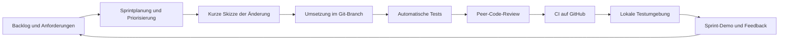

# Sprint 3: "Prototype your solution"

Projekt: **SmartSave - Smart Home für alle**
Zeitraum laut Aufgabenstellung: **Tag 5 bis 8**

---

## 1. Sprintziel

Am Sprintende gibt es einen einfachen, vorführbaren Website-Prototyp. Eine Nutzerin kann ein
Smart-Home-Paket auswählen, ihre bisherigen Energiekosten eingeben, eine grobe Ersparnis sehen
und den Ablauf bis zu einer Testbestellung durchlaufen. Außerdem sind der SDLC und die ersten
Grundzüge der Pipeline dokumentiert.

Der Prototyp ist bewusst klein gehalten. Echte Bestellungen, Benutzerkonten, Gerätedaten und
Zahlungen gehören noch nicht zu Sprint 3.

## 2. Sprintplanung

### Scrum-Rollen

- **Product Owner:** priorisiert das Backlog und klärt Anforderungen.
- **Scrum Master:** moderiert Dailys und Retrospektive und hilft bei Hindernissen.
- **Entwicklungsteam:** setzt die Aufgaben um und prüft den Prototyp.

Die Namen der Teammitglieder werden vom Team auf dem Planungsboard ergänzt.

### Planungsboard

Vorgesehene Spalten: `Backlog`, `To Do`, `In Progress`, `Review`, `Done`.

| ID | Aufgabe | Priorität | Abnahmekriterium | Status |
|---|---|---|---|---|
| S3-1 | Vorhandenen Website-Stand prüfen | Must | Fehler und fehlende Teile sind festgehalten | Done |
| S3-2 | Paket-Konfigurator funktionsfähig machen | Must | Komponenten und Vorlagen können hinzugefügt und entfernt werden | Umgesetzt - Teamreview offen |
| S3-3 | Energiekosten und Beispielersparnis berechnen | Must | Eingabe verändert die sichtbare Schätzung | Umgesetzt - Teamreview offen |
| S3-4 | Warenkorb als Abschluss des Klick-Prototyps bauen | Must | Auswahl und Monatswerte werden übernommen | Umgesetzt - Teamreview offen |
| S3-5 | Inhalte an SmartSave-Konzept angleichen | Must | Name, 24 Monate und Eigentumsübergang sind einheitlich | Umgesetzt - Teamreview offen |
| S3-6 | Automatische Tests für die Kernlogik ergänzen | Should | Tests laufen lokal; GitHub Actions ist dafür konfiguriert | Umgesetzt - CI-Lauf nach Push offen |
| S3-7 | SDLC und Pipeline dokumentieren | Must | Ablauf, Priorisierung, QS und Deployment sind beschrieben | Umgesetzt - Teamreview offen |
| S3-8 | Peer-Feedback und Retrospektive durchführen | Must | Einträge wurden mit dem Team ausgefüllt | Offen - Teamtermin nötig |

### Definition of Done für Sprint 3

Eine Aufgabe ist fertig, wenn sie im Browser vorführbar ist, keine bekannten Fehler im
Kernablauf enthält, ein zweites Teammitglied sie geprüft hat und vorhandene automatische Tests
erfolgreich laufen.

## 3. Umgesetzter Prototyp

Der aktuelle Prototyp liegt unter [`smarthome/`](../smarthome/README.md) und besteht aus:

1. **Startseite:** erklärt Produktidee, Ablauf und Beispielpakete.
2. **Konfigurator:** lädt Starter- oder Komfortpaket, fügt einzelne Komponenten hinzu und
   entfernt sie wieder.
3. **Ersparnis-Rechner:** vergleicht die geschätzte Ersparnis mit den monatlichen Abo-Kosten.
4. **Warenkorb:** übernimmt Paket und Energiekosten und beendet den Ablauf mit einer
   gekennzeichneten Testbestellung.

Die Schätzung arbeitet mit einfachen Prozentwerten je Komponente und ist auf 30 Prozent
begrenzt. Sie ist keine echte Energieberatung, sondern macht die Produktidee testbar.

Der ältere PHP-Versuch unter `prototype/` bleibt als technische Vorarbeit im Repository. Für die
Sprint-3-Demo wird die von der Gruppe begonnene Website unter `smarthome/` verwendet.

## 4. Software Development Life Cycle (SDLC)



- **Priorisierung:** Must-Aufgaben zuerst, danach Should und Could.
- **Qualitätssicherung:** JavaScript-Tests, Prüfung der lokalen Dateiverweise, PHP-Tests für den
  älteren Prototyp, manuelle Browserprüfung und Review durch ein Teammitglied.
- **Git-Arbeit:** Kleine Commits auf einem Feature-Branch, anschließend Pull Request und Review.
- **Deployment in Sprint 3:** Lokale Testumgebung über einen einfachen Webserver.
- **Späterer Ausbau:** Automatisches Deployment in eine gemeinsame Testumgebung gehört zu
  Sprint 4.

## 5. Erste Grundzüge der Pipeline

Die GitHub-Actions-Pipeline in `.github/workflows/ci.yml` führt aktuell aus:

1. Repository auschecken.
2. PHP und Node.js einrichten.
3. Composer-Datei validieren und Abhängigkeiten installieren.
4. PHP-Syntax prüfen und PHPUnit-Tests ausführen.
5. JavaScript-Logik sowie lokale HTML-, CSS- und Scriptverweise testen.

Damit ist der Einstieg in eine Pipeline vorhanden. Ein echtes Deployment ist als offener
Ausbauschritt dokumentiert.

## 6. Vorführung

```powershell
cd smarthome
python -m http.server 8080
```

Danach im Browser `http://localhost:8080` öffnen. Der Demo-Ablauf ist:

1. Starter-Paket auswählen.
2. Energiekosten ändern und Ergebnis beobachten.
3. Eine Komponente hinzufügen oder entfernen.
4. Zum Warenkorb gehen.
5. Testbestellung abschließen.

## 7. Peer-to-Peer-Feedback

| Feedback von Team | Beobachtung | Beschlossene Anpassung |
|---|---|---|
| Noch auszufüllen |  |  |

## 8. Retrospektive

- **Was lief gut:** Noch gemeinsam ausfüllen.
- **Was sollte verbessert werden:** Noch gemeinsam ausfüllen.
- **Maßnahme für Sprint 4:** Noch gemeinsam festlegen.

Die organisatorischen Punkte bleiben offen, weil sie nur nach einem echten Teamtermin sinnvoll
ausgefüllt werden können. Sie stehen zusätzlich in [`OFFENE_TODOS.md`](../OFFENE_TODOS.md).
