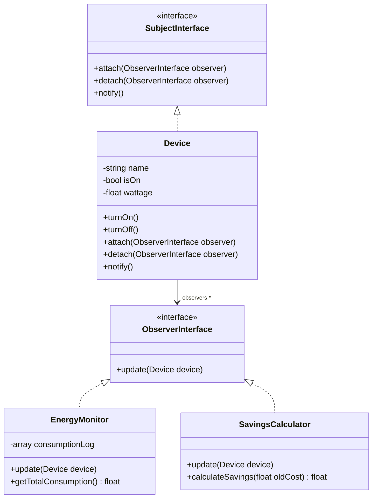

# Sprint 4: Features & Design Pattern

Projekt: **SmartSave** – Smart Home für alle

---

## 1. Reflektion Design Thinking & agiler Prozess

**Verwendete Methoden (Überblick):**
Problem Tree, Persona, Empathy Map, Problem Statement (5W), 6-3-5 Brainwriting (problem- & solution-based), Problem+Solution Stands, Customer Journey Mapping, Customer Profile & Value Map, Walt Disney Methode, Business Model Canvas, Backlog Grooming, Scrum (Dailys, Sprintplanung, Retrospektive), Peer-to-Peer Feedback.

**Mehrwert:** Der iterative Wechsel zwischen Problem- und Lösungsraum verhinderte eine vorschnelle Lösungsfixierung. Die Empathy Map und Persona sorgten dafür, dass Entscheidungen (z. B. Abo- statt Kauf-Modell) konsequent aus Kundensicht getroffen wurden.

**Hürden:** Design Thinking erfordert Geduld – mehrfaches Verwerfen von Ideen (z. B. Genossenschaftsmodell, reines Leasing) kostete Zeit, führte aber zu einer robusteren Lösung. Die Balance zwischen kreativer Offenheit (Dreamer) und wirtschaftlicher Machbarkeit (Realist) war herausfordernd.

**Teamprozess:** Rollenverteilung nach Scrum (Product Owner, Scrum Master, Entwicklungsteam), tägliche Dailys, Peer-Feedback am Ende jedes Sprints zur externen Qualitätssicherung der Ergebnisse.

---

## 2. Ist-Zustand des Geschäftsprozesses (Zusammenfassung)

Siehe im Detail: [Projektkonzept.md](../Projektkonzept.md), [Sprint1_Define_Understand.md](./Sprint1_Define_Understand.md), [Sprint2_Sketch_Solution.md](./Sprint2_Sketch_Solution.md)

- **Problem:** Hohe Anschaffungskosten verhindern Zugang zu energiesparender Smart-Home-Technik für Haushalte mit mittlerem Einkommen
- **Lösung:** SmartSave-Abo, finanziert durch die eigene Energieersparnis, Eigentumsübergang nach 24 Monaten
- **Zielgruppe:** Persona "Sandra Wagner" – preissensible Familie mit Interesse an Nachhaltigkeit
- **Customer Journey:** Awareness → Rechner → Vertragsabschluss → Selbstinstallation → laufender Betrieb → Vertragsende/Eigentum
- **Business Canvas:** siehe Sprint 2
- **SDLC:** siehe Sprint 3
- **Risiken:** Abweichung der realen von der kalkulierten Ersparnis, Zahlungsausfallrisiko über 24 Monate, Datenschutzanforderungen (DSGVO)
- **Chancen:** Neuer, bisher unerschlossener Kundenkreis; Beitrag zu SDG 12; Folgegeschäft durch Anschlussverträge

---

## 3. Design Pattern: Observer Pattern

### 3.1 Warum dieses Pattern?
Im SmartSave-Prototyp müssen mehrere Komponenten (Verbrauchsanzeige in der App, Einsparungs-Berechnung, ggf. spätere Benachrichtigungen) informiert werden, sobald sich der Zustand eines smarten Geräts ändert (an/aus, Verbrauchswert). Das **Observer Pattern** (Verhaltensmuster) entkoppelt das "Subjekt" (Gerät) von den "Beobachtern" (Verbrauchsüberwachung, Anzeige), sodass beliebig viele Beobachter hinzugefügt werden können, ohne das Gerät selbst anzupassen.

### 3.2 UML-Klassendiagramm

### 3.3 Implementierung
Siehe Quellcode: [prototype/src/Observer/ObserverInterface.php](../prototype/src/Observer/ObserverInterface.php), [prototype/src/Observer/SubjectInterface.php](../prototype/src/Observer/SubjectInterface.php), [prototype/src/Device.php](../prototype/src/Device.php), [prototype/src/EnergyMonitor.php](../prototype/src/EnergyMonitor.php).

Das Pattern wird mit einem automatisierten Test unterstützt: [tests/EnergyMonitorTest.php](../tests/EnergyMonitorTest.php).

### 3.4 Anwendungsbereiche
- **Smart Home / IoT:** Geräte-Statusänderungen benachrichtigen mehrere Systeme (App, Logging, Automatisierungsregeln) – genau unser Anwendungsfall
- **UI-Frameworks:** Model-View-Bindings (z. B. Datenänderung aktualisiert automatisch mehrere UI-Elemente)
- **Event-Systeme:** Publish/Subscribe-Mechanismen, z. B. bei Nachrichten-Warteschlangen
- **Weitere Frameworks (could have):** Vue.js/React State-Management (reaktive Systeme basieren konzeptionell auf Observer-Ideen)

### 3.5 Übung für den Design-Pattern-Workshop
1. Ergänzt einen weiteren Observer `NotificationService`, der eine Konsolen-/Log-Ausgabe erzeugt, sobald ein Gerät eingeschaltet wird.
2. Schreibt einen Unit-Test, der prüft, dass beim Aufruf von `Device::turnOn()` alle registrierten Observer benachrichtigt werden.
3. Diskutiert: Welche Nachteile hat das Observer Pattern bei sehr vielen Observern (Performance, Reihenfolge der Benachrichtigung)?

---

## 4. Backlog-Abnahme (Auszug erledigter Items aus Sprint 2-4)

| ID | User Story | Status |
|---|---|---|
| B1 | Verbrauch eingeben für individuelles Angebot | erledigt (Prototyp) |
| B2 | Geräte per App ein-/ausschalten | erledigt (Prototyp) |
| B3 | Verbrauch/Ersparnis anzeigen | erledigt (Prototyp) |
| B9 | CI-Pipeline mit automatisierten Tests | erledigt |
| B6 | Online-Rechner zur Ersparnis-Simulation | erledigt (Prototyp) |
| B4, B5, B7, B8, B10 | Automatisierungsregeln, Notifications, Support-Ansicht, Eigentumsbestätigung, DSGVO-Self-Service | offen – Backlog für Folge-Lernfeld (LF11) |

---

## 5. Ausblick auf LF11
- Funktionalität des Prototyps erweitern (Automatisierungsregeln, Benachrichtigungen)
- Deployment-Pipeline ausbauen (Continuous Deployment, Testabdeckungsmessung, Monitoring)
- Weitere Design Patterns bei Bedarf ergänzen (z. B. Strategy für unterschiedliche Tarif-/Berechnungsmodelle)
- Skalierbarkeit der Anwendung reflektieren

## Retrospektive Sprint 4 / Klassenreflexion (Platzhalter)
- **Beibehalten:**
- **Verbessern für LF11:**
